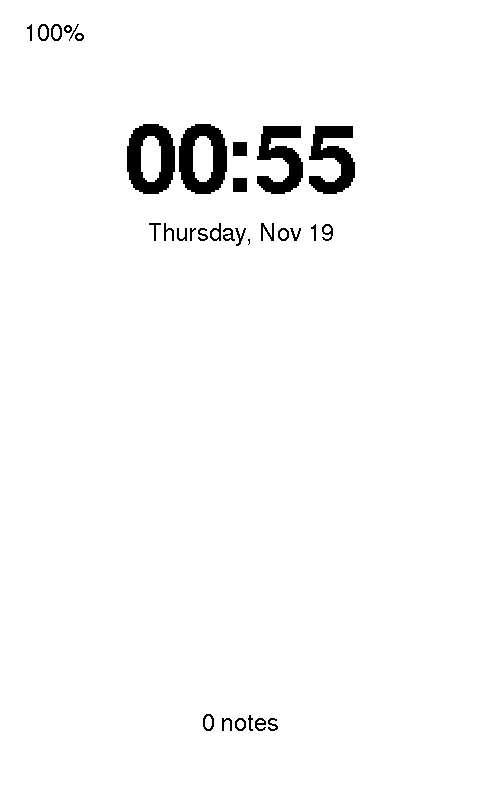
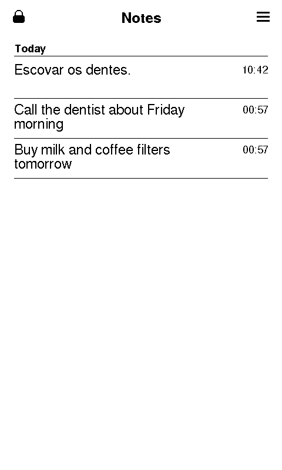
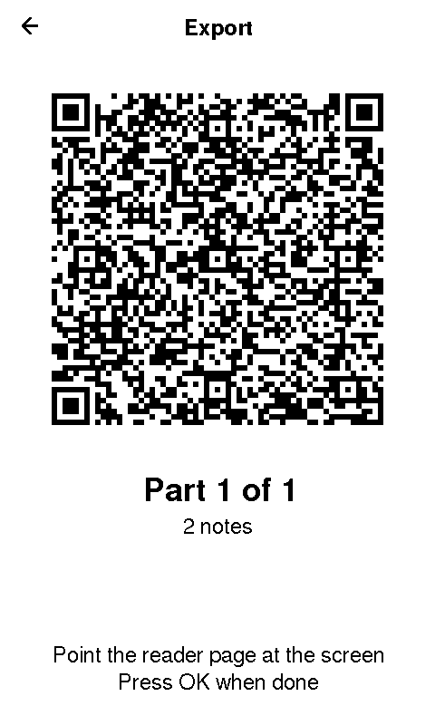

# BrainOS

A voice notebook for the [Seeed reTerminal Sticky](https://www.seeedstudio.com/sticky/), the 3.97" magnetic e-paper board. Hold the button, say the idea, let go: the board keeps the recording and turns it into text through OpenRouter (Whisper) when it has Wi-Fi, in Portuguese or English. The notes live on the board, on a page in your home network (`http://brain.local`), and travel to a phone as QR codes.

Built on [Sticky OS](https://github.com/Sticky-OS/sticky-os) (MIT): its screen, touch and button plumbing, keyboard, settings store and update mechanism. Everything else was removed or rewritten. Not affiliated with Seeed Studio.

  

## What it does

- **Lock screen**: battery, a big clock, the date, the pinned note, how many notes there are.
- **Notes**: grouped by day. Open one to pin it to the lock screen, edit it on the keyboard, or delete it.
- **Record**: hold OK anywhere, speak, release. The recording waits in a queue; with Wi-Fi and an OpenRouter key it becomes text in a few seconds.
- **Wi-Fi window**: the radio stays on for 30 minutes after the last touch (or while recordings wait), then switches off. Any touch brings it back.
- **brain.local**: a page on your network to paste the OpenRouter key, read, pin, archive and delete notes, download them as Markdown, and change settings.
- **Export**: a loop of QR codes with the new notes; the [reader page](https://carcaralivre.github.io/brainos-reader/) on the phone reads them in any order. Format: [docs/qr-payload.md](docs/qr-payload.md).
- **Archive** (notes that were exported, by default), **Settings** on the board (Wi-Fi with a scan and a keyboard, date and time, sound, update, about), **updates over Wi-Fi** from this repository's releases, with rollback.

## Install

Open the [Install page](https://carcaralivre.github.io/brainos/) in Chrome or Edge with the board on USB. Or by hand, from a [release](https://github.com/carcaralivre/brainos/releases):

```bash
esptool --chip esp32s3 --baud 115200 write-flash 0x0 brainos-full.bin
```

115200 baud only: the board's USB chip drops faster transfers.

## Build

arduino-cli, ESP32 core 3.3.11, Adafruit GFX 1.12.6 and BusIO 1.17.4 (see `.github/workflows/build.yml`). Then:

```bash
firmware/build.sh build   # into ~/.cache/brainos-build
firmware/build.sh         # build and flash over USB
```

Serial commands at 115200 (for development): `shot` (a screenshot; `firmware/tools/shot.py` saves it as PNG), `stats`, `notes`, `note add <text>`, `wifi`, `wifi add <ssid> <password>`, `time YYYY-MM-DD HH:MM`, `tap x y`, `ok`, `move n`, `lock`, `sleep`, `nettest`.

`spike/sticky-stt/` is the on-chip speech-to-text experiment that decided against local transcription ([docs/stt-spike.md](docs/stt-spike.md)). It is not part of the firmware.

## Layout

| Where | What |
|---|---|
| `firmware/brainos/` | the sketch: `board`, `screen`, `touch`, `rtc` (hardware); `notes`, `capture`, `stt`, `net`, `web`, `export`, `ota` (features); `ui`, `keyboard` (screens) |
| `firmware/build.sh`, `firmware/tools/` | build, flash, screenshots, serial driving |
| `site/` | the Install page (esp-web-tools), deployed to GitHub Pages by the release workflow |
| `docs/` | the QR payload spec, the guide, the spike's record, screenshots |

MIT, see LICENSE.
